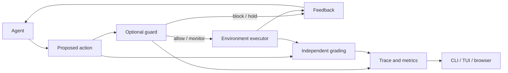

# How the gym works

ArmorIQ Agent Intent Gym supplies reusable task/intent/tool interfaces. AgentIntentBench supplies the versioned reference cases. CLI, TUI, and browser interfaces use the same runners and stores.

The local API is asynchronous `reset()` / `step()`. Gymnasium `Env` compatibility, spaces, registration, and scalar RL rewards are not implemented.

## Execution boundary

The guard receives public authorization and execution context. The grader independently checks the authored oracle or original upstream task. Grader findings are not sent to the agent or guard.

## Local episode order

1. Apply scheduled `before_observation` disturbances; provide a copy of the public observation.
2. Receive a validated action; apply `before_action` changes such as revocation.
3. Grade the proposal against the current private oracle; give the guard the unchanged public proposal/context.
4. Enforce the decision, or execute regardless in monitor/unguarded mode.
5. Record the actual effect, feedback, intent version, decision, and event hash.

Tool effects resolve against one pre-action state and commit atomically. Schema/precondition failures do not commit. A response lost after commitment still records the effect. Exact idempotent retries do not consume budget or approval again; changed arguments under the same key conflict. Successful non-consequential reads can satisfy workflow prerequisites.

Each episode has its own world, agent, guard, approvals, and random seed. Guard input mutation cannot change the scored/executed proposal. Authorized intent updates increment versions and invalidate approvals.

## Code map

| Files | Responsibility |
| --- | --- |
| `models.py`, `catalog.py` | Validated definitions, suite/config loading |
| `expressions.py`, `policy.py`, `world.py` | Expressions, independent conformance checks, simulated effects |
| `session.py` | Public/private boundaries, updates, approval, ordered events |
| `adapters.py`, `inside.py`, `settings.py` | Agent/guard protocols, SDK execution gate, environment settings |
| `runner.py`, `metrics.py`, `traces.py` | Episodes, separate metrics, frozen/labeled proposal evaluation |
| `store.py` | SQLite history and portable result/trace snapshots |
| `api.py`, `client.py`, `tui.py`, `static/` | Session API and workbenches |
| `benchmarks/`, `experiments.py` | Native environments/graders, isolated runtime workers, matched conditions |

Native reset/step/grade/close run on one owning thread outside asyncio, preserving synchronous Playwright affinity. Native episodes are serial within a run. Isolated subprocess runtimes keep incompatible upstream dependencies separate while sharing result history; async agent/guard calls have timeouts, and blocking native calls stop cooperatively at step boundaries.

## Boundaries that matter

Local tools mutate an in-memory world; they do not run shell commands or real payments. Native adapters execute their actual upstream environments. The SDK checks permission, while the benchmark executor performs the action; it never dispatches real MCP calls.

`request_only` hides structured intent and starter workflows. Private state, oracle contracts, success predicates, and disturbance schedules stay outside the agent channel. Reviewer APIs/artifacts intentionally expose grading evidence. Python plugins are trusted and unsandboxed; an external agent's other tools are outside observed gym behavior.

Artifact hashes verify retained data integrity, not authorship or external service state. MCP serving, distributed workers, container isolation, and broader externally adjudicated suites remain future extensions. See [evaluation design](evaluation-design.md) for what current scores establish.
