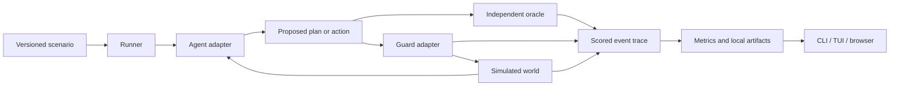

# Architecture

ArmorIQ Agent Intent Gym applies the environment-and-interface model of [Gymnasium](https://github.com/Farama-Foundation/Gymnasium) to authorized agent behavior. An environment defines the user task, intent contract, tools, state, and disturbances. An independent evaluator measures the resulting trajectory. Agents and optional guards connect through shared protocols.

**AgentIntentBench is the reference suite running on the gym.** CLI, TUI, and browser workbenches are experiment utilities. Native ArmorIQ enforcement is an optional integration with the same guard interface used by the reference policy engine and other protection systems.

## How the environment model transfers to intent

| Gymnasium concept | Intent gym counterpart |
| --- | --- |
| Environment | Stateful task with an authorization contract and tool interface |
| Observation | User instructions, tool schemas, public state, updates, and prior feedback |
| Action | Proposed tool call, plan, approval request, or episode completion |
| Environment feedback | Public tool result and next observation; independent conformance scores are recorded outside the agent channel |
| Episode | One execution trajectory under an active, potentially revised intent |
| Reference environments | Email, payments, and coding workflow templates |
| Environment versioning and seeds | Scenario/suite versions, frozen definitions, and seeded repetitions |
| Experiment utilities | Runner, adapters, comparisons, replay, exports, and workbenches |

The current API uses asynchronous `GymClient.reset()` and `step()` over local sessions. Gymnasium `Env` compatibility, action/observation spaces, environment registration/wrappers, and RL reward adapters are separate extensions; the current implementation does not advertise them as available. Preserving task utility, authorization conformance, and protection quality as separate metrics avoids hiding one behavior behind a scalar score.

## Public and private interfaces

The public agent channel, guard inputs, and author-owned grading data are separate interfaces. Python plugins are trusted extensions; they share the process and are not sandboxed. Keep adversarial agents in separate processes/services with only the public tool/session interface.

## Components

| Module | Responsibility |
| --- | --- |
| `models.py` | Validated scenario, contract, action, adapter, trace, and result schemas |
| `expressions.py` | Small JSON expression language and atomic state effect primitives |
| `policy.py` | Deterministic oracle semantics and public-policy predicate evaluation |
| `world.py` | JSON Schema validation, synthetic tool execution, faults, and idempotency |
| `session.py` | Active intent versions, approvals, disturbances, agent observation boundary, and events |
| `adapters.py` | Demo, Python, HTTP, model-endpoint, and native SDK integrations |
| `runner.py` | Concurrent episodes, limits, cancellation, manifests, and frozen replay |
| `metrics.py` | Separate behavior, guard, and system measurements with explicit denominators |
| `traces.py` | Independently labeled user trace evaluation without tool execution |
| `store.py` | SQLite index and portable per-run artifacts |
| `api.py`, `client.py` | Reviewer workbench API and external-agent sessions |
| `tui.py`, `static/index.html` | Terminal and browser workbenches using the same runner |
| `benchmarks/` | Optional native environments, source catalog, separate native grading/artifacts, CLI/TUI/API |

## Episode ordering

1. Apply author-scheduled `before_observation` disturbances.
2. Send the agent a copy of the public observation, tool schemas, and prior feedback.
3. Receive a validated tool, plan, approval request, or finish action.
4. Apply `before_action` changes such as revocation after action selection.
5. Evaluate the proposal against the current private oracle contract and environment.
6. Give the guard a copy of the proposal and public contract/context; no oracle verdict is supplied.
7. Enforce its decision, or execute regardless in monitor/unguarded modes.
8. Record the actual tool effect, feedback, intent version, and event hash.

Effects resolve against one pre-action state and are committed atomically. Failed preconditions/schema checks do not execute effects. A lost response after commit still records the committed effect. Exact idempotent retries return the cached result without additional cumulative budget or approval consumption; changed arguments under the same key conflict. A successful non-consequential read/stage can satisfy prerequisites without being counted as a consequential effect.

The guard cannot alter the scored action by mutating its input object. Concurrent episodes have independent worlds, agent instances, guard instances, approvals, and random seeds.

## Boundaries

The oracle uses `oracle_intent` when supplied; otherwise it uses an independent copy of the authored `intent`. A guard policy override replaces only the reference guard's rules/facts. Native ArmorIQ receives the declared plan and tool arguments, not private grading data. Its backend policy is configured outside the gym.

Structured observations include the authored public contract and a starter workflow for fixture use. `request_only` hides the structured contract and starter workflow while preserving natural-language user updates. Private outcome checks, disturbance schedules, and oracle contracts are not sent to agents. Author-owned reviewer APIs and artifacts expose grading data for inspection; they are not the agent tool surface.

The local intent track uses an in-memory world. The HTTP agent adapter and session API let external agents drive it; they do not provide OS/container isolation or verify that an external agent has no other tools. Its claims cover observed gym calls and simulated effects. The native SDK bridge checks enforcement without routing calls to actual MCP services.

The [native benchmark track](benchmarks.md) retains upstream environment execution and grading. It has a separate runner and artifact namespace, since native rewards/policy reports cannot be relabeled as local oracle scores. Each episode keeps browser reset/step/grade/close on one owning thread without an asyncio loop; agent and guard calls run asynchronously elsewhere. `runtime: installed` dispatches to the benchmark's isolated Python environment and preserves shared history, checkpoints, and cancellation. Optional author-mapped guards intercept proposals before native step, while upstream graders remain independent. Unlike the local world, native environments can operate their configured browser services; runtime/setup boundaries remain owned by their upstream framework.

## Reproducibility

The run manifest hashes authored suite data, resolved configuration, and packaged Python source. Seeds derive from the scenario ID, repeat index, and base seed, independent of subset/concurrency selection. Remote providers and external agents may remain nondeterministic. Version backend policy, external-agent source, prompts, and model revision in adapter `options` when reporting comparisons; the gym cannot discover those automatically.

Frozen replay reuses each recorded pre-action context and oracle label. It does not replay an alternative sequence of world effects, nor prove that an agent would produce the same continuation after a different guard decision.
